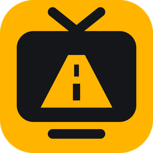
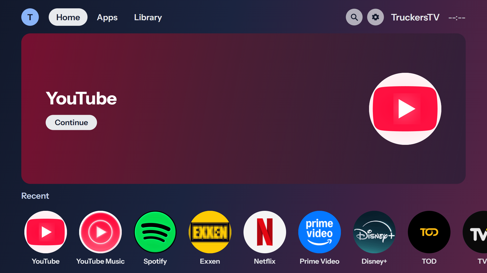
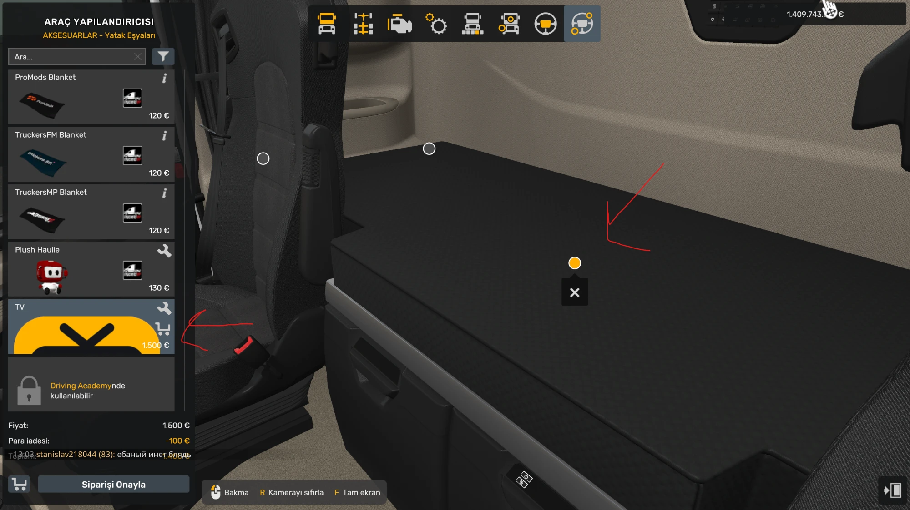
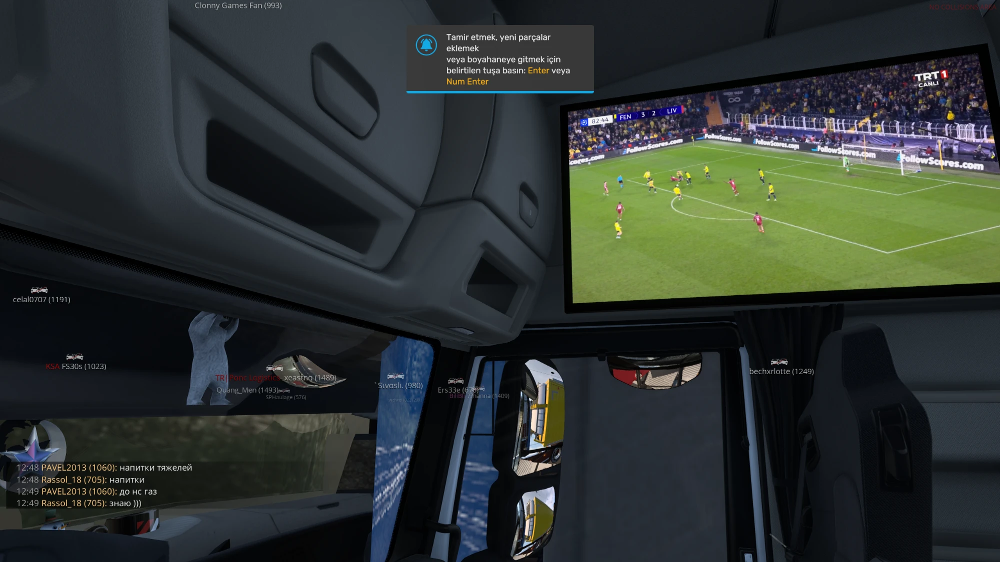
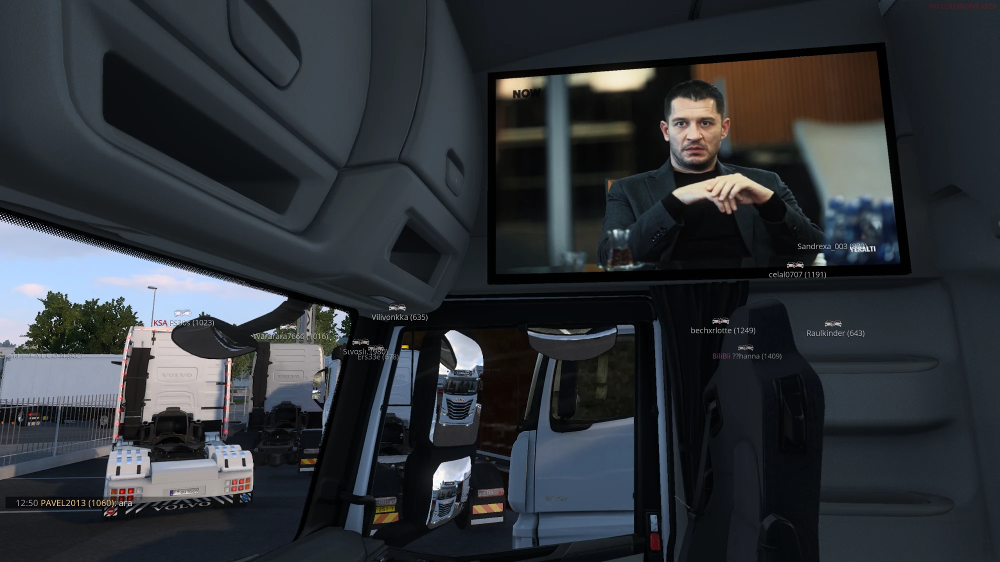
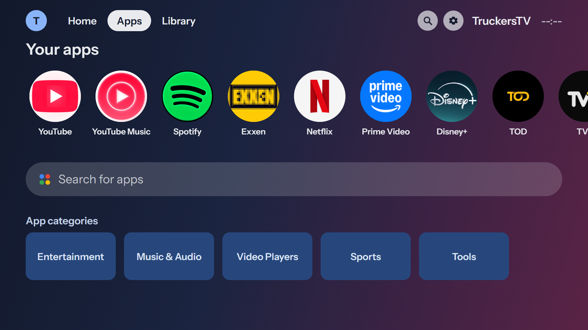
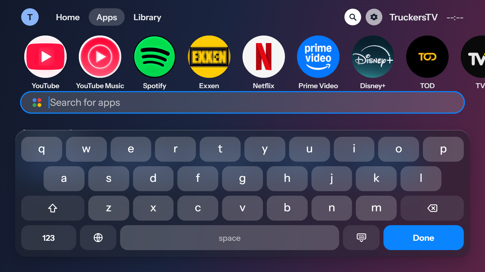
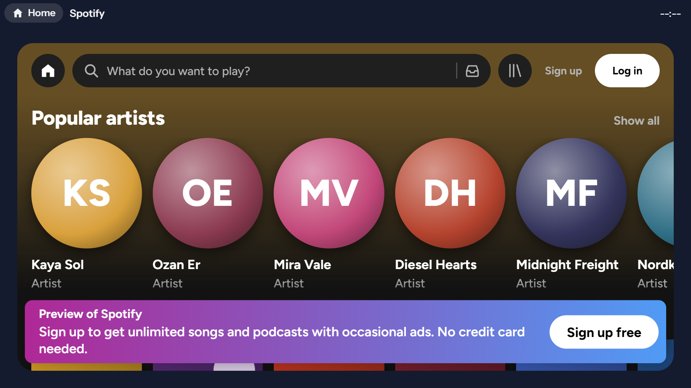
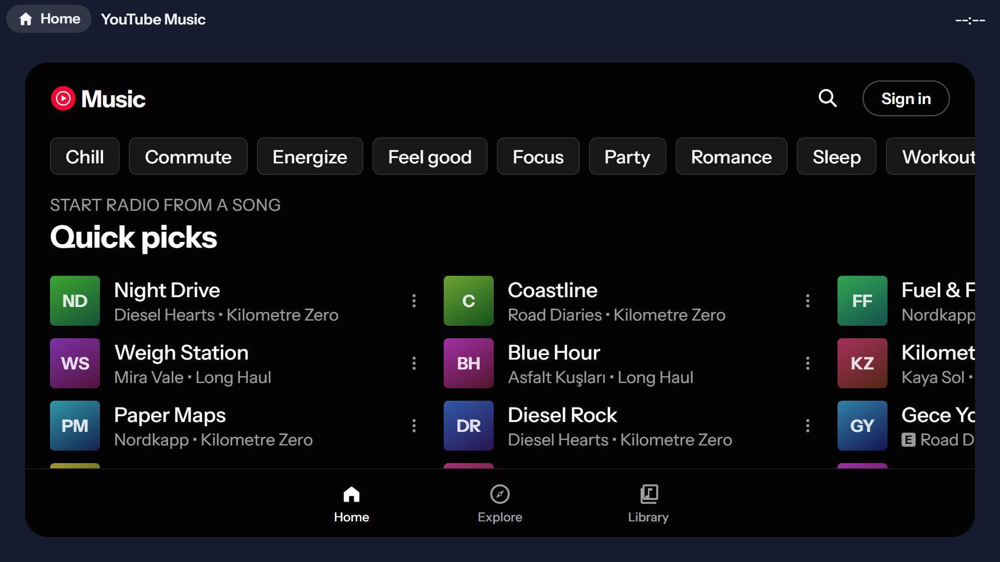
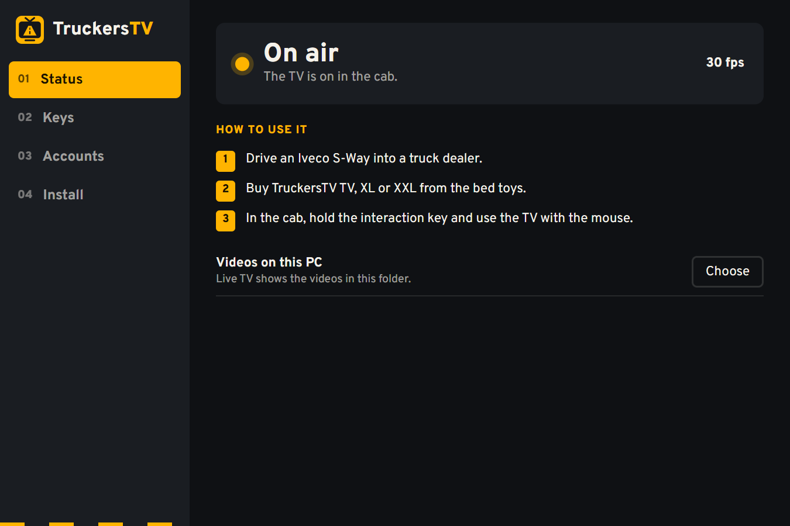

<p align="center"></p>

<h1 align="center">TruckersTV</h1>

<p align="center">
  <b>A television in the cab of your truck in Euro Truck Simulator 2.</b><br>
  An Android TV style home screen with YouTube, music, live TV, a browser and your own videos.
</p>

<p align="center">
  <a href="https://github.com/DrLemony/TruckersTV/releases"></a>
  
  
  
  <a href="LICENSE"></a>
</p>

<p align="center"></p>

> **Beta.** Expect rough edges, and the TV goes in every truck of the game but the Renault Magnum and the Renault E-Tech T. Bugs and ideas are welcome in [Issues](https://github.com/DrLemony/TruckersTV/issues).

## Download

Get the installer from the [latest release](https://github.com/DrLemony/TruckersTV/releases) and run it. It isn't code signed yet, so Windows SmartScreen may warn you: choose *More info*, then *Run anyway*.

## What it is

TruckersTV is a Windows app and a game plugin. The TV is bought in the game's own truck shop, under *Bed toys*, as "TV" (1500 €). Its size and place in the cab are set from the TruckersTV window, live while the game runs, and kept. It is drawn into the cab, and the truck's own screens stay the game's. There's no mod to install by hand, so it also runs under TruckersMP.

It starts on the cab's right-hand wall, by the bed (in the Iveco S-Way, over the right door), and you move it from there: each cab is a little different.

## Using it

1. Open TruckersTV before the game and go through its setup.
2. In the game, drive your truck into a truck dealer and buy the **TV** under *Accessories › Bed toys*. Its size and place are set on the TV page of the TruckersTV window: press *Save* to keep them.

   

3. Hold the interaction key to take the mouse: the cursor moves on the TV, a click clicks, the keyboard types.

## Screens





| | |
|---|---|
|  |  |
|  |  |

The companion app on the PC shows the TV's state, its keys and your accounts:

<p align="center"></p>

*Taken from the app's preview, outside the game: the artists and songs shown are sample data.*

## Türkçe

TruckersTV, Euro Truck Simulator 2'de tırın kabinine televizyon koyar: YouTube, müzik, canlı TV, tarayıcı ve kendi videoların, Android TV tarzı bir ana ekranla. Şu an beta ve Renault Magnum ve Renault E-Tech T dışındaki bütün tırlarda çalışıyor; TruckersMP ile uyumlu.

[Son sürümden](https://github.com/DrLemony/TruckersTV/releases) kurulum dosyasını indir ve çalıştır, sonra oyundan önce TruckersTV'yi aç. Televizyonu oyunda tır galerisinden, *Aksesuarlar › Yatak Eşyaları* altından **TV** adıyla satın alırsın (yukarıdaki resim). Boyutunu ve yerini oyun açıkken TruckersTV penceresinden değiştirip kaydedebilirsin. Windows uyarı verirse *Ek bilgi*, ardından *Yine de çalıştır*'a bas.

## Building

```bash
npm ci --prefix ui
npm run build:release --prefix ui
cargo build --release -p westplay-app -p westplay-plugin --features tauri/custom-protocol
```

The installers are built from this repository by the [release workflow](.github/workflows/release.yml).

## Code signing policy

Free code signing provided by [SignPath.io](https://signpath.io), certificate by [SignPath Foundation](https://signpath.org).

- Committers and approvers: [DrLemony](https://github.com/DrLemony)

Privacy: TruckersTV sends nothing to any server on its own. It only opens the sites and services you choose in it.

## License

[GPL-3.0-or-later](LICENSE). Euro Truck Simulator 2 is a trademark of SCS Software. TruckersTV isn't affiliated with SCS Software, TruckersMP, Google or the services it opens. Android TV is a trademark of Google, named only to describe the look.

<sub>A modified version of [WestPlay](https://github.com/enes-less/WestPlay) by enes-less, with the browser core of [Helow19274/WestPlay](https://github.com/Helow19274/WestPlay).</sub>
